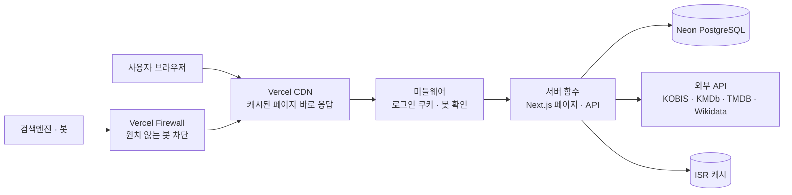

# 🎬 STILL THEATER

> 영화를 보고 남은 여운을 별점과 한줄평으로 기록하는 영화 리뷰 서비스

**🔗 서비스 바로가기: [stilltheater.com](https://stilltheater.com)**

---

## 목차

- [서비스 소개](#서비스-소개)
- [주요 기능](#주요-기능)
- [사용 기술](#사용-기술)
- [시스템 구조](#시스템-구조)
- [운영하며 해결한 문제](#운영하며-해결한-문제)
- [개발 방식](#개발-방식)
- [소스 코드 안내](#소스-코드-안내)

---

## 서비스 소개

STILL THEATER는 영화를 본 뒤 **별점, 한줄평, 항목별 평점**을 남기고, 다른 사람들의 평가를 함께 볼 수 있는 영화 리뷰 서비스예요.

영화 한 편을 "좋았다 / 별로였다"로만 남기기 아쉬운 사람을 위해, **연출·연기·음악처럼 항목을 나눠 평가**할 수 있게 만들었어요. 리뷰가 공감을 받을수록 사용자 등급이 올라가는 구조로, 꾸준히 기록하는 재미를 더했어요.

| 항목 | 내용 |
|---|---|
| 서비스 | 영화·시리즈 평점과 리뷰 기록 |
| 주소 | https://stilltheater.com |
| 개발 기간 | 2026년 8월 ~ 현재 (운영 중) |
| 개발 인원 | 1인 (기획, 디자인, 개발, 배포, 운영) |

---

## 주요 기능

### 영화 정보와 평가
- **박스오피스**: 영화진흥위원회(KOBIS) 일별 박스오피스
- **영화·시리즈·인물 정보**: KOBIS, KMDb, TMDB 데이터를 합쳐 상세 정보, 공식 예고편, 출연진, 필모그래피 제공
- **둘러보기**: 장르별 영화, 현재 상영 중인 영화, TV·시리즈물, 올해의 Best
- **별점, 한줄평, 장문평**: 영화마다 별점과 한줄평·장문평 작성, 공감·싫어요, 스포일러 가리기, 공감순·최신순·팔로잉 정렬
- **항목별 평점**: 전체 평점과 별도로 연출, 연기, 각본, 음악, 편집을 따로 평가
- **수상 기록**: 주요 영화제 수상 이력 표시

### 개인화
- **추천**: 내가 남긴 평점을 바탕으로 한 영화 추천과 "추천 N%" 표시 (협업 필터링 기반)
- **나만의 영화 리스트**: 영화 상세에서 바로 리스트에 추가
- **팔로우**와 즐겨찾기, 알림

### 커뮤니티
- **사용자 등급**: 리뷰가 받은 공감 수에 따라 관객 → 씨네필 → 평론가 → 거장
- **영화제 수상작 투표**: 부문별로 수상작을 예측하고 투표 현황 확인

### 계정과 운영
- **소셜 로그인**: Google, 카카오, 네이버 + 아이디 로그인
- **고객센터**: 공지사항과 문의
- **관리자 도구**: 수상작, 공식 예고편 등 관리
- **저작권 정책과 신고 페이지**

---

## 사용 기술

| 분야 | 기술 |
|---|---|
| 프레임워크 | Next.js (App Router), React, TypeScript |
| 데이터베이스 | PostgreSQL (Neon, 서버리스), Prisma ORM |
| 인증 | NextAuth (Google · Kakao · Naver OAuth, 아이디 로그인) |
| 이메일 | Resend |
| 배포 · 인프라 | Vercel (CDN, ISR 캐시, 서버리스 함수, Firewall) |
| 외부 데이터 | KOBIS, KMDb, TMDB, Wikidata |
| 품질 관리 | ESLint, TypeScript 타입 검사, 단위 테스트 |

---

## 시스템 구조

- **비로그인 방문자**는 로그인 정보를 읽지 않는 공용 페이지를 받아요. 공용 페이지는 한 번 만들어 CDN과 ISR 캐시에 저장하고, 리뷰나 평점이 바뀔 때만 즉시 새로 만들어요.
- **로그인한 사용자**는 내 리뷰, 내 별점이 들어간 개인 페이지를 받아요. 개인 페이지는 캐시하지 않아서 다른 사람에게 보이지 않아요.
- **외부 API 결과**는 DB와 캐시에 저장해 같은 데이터를 반복해서 부르지 않아요. 박스오피스는 API 한도를 넘거나 장애가 나도 마지막으로 성공한 데이터로 보여 줘요.

---

## 운영하며 해결한 문제

실제 사용자가 들어오면서 무료 플랜 한도를 넘어 사이트가 멈추는 일을 여러 번 겪었어요. 문제마다 **숫자로 원인을 찾고, 고치고, 다시 측정**했어요. 자세한 기록은 [docs/troubleshooting.md](docs/troubleshooting.md)에 있어요.

| 문제 | 찾은 방법 | 해결 | 결과 |
|---|---|---|---|
| 포스터 이미지 변환이 무료 한도의 3배를 넘어 사이트 정지 | Vercel 사용량 화면에서 항목별 사용량 확인 | 이미지 원본 서비스의 작은 크기 이미지를 바로 받는 이미지 로더 작성 | 이미지 변환 **17,000회 → 0회** |
| 요청의 약 93%가 매번 서버에서 새로 실행 | CDN 요청 수와 함수 실행 수 비교 | 헤더의 로그인 조회를 분리하고 비로그인 공용 페이지를 캐시 | 비로그인 페이지 두 번째 요청부터 캐시 응답 |
| 평점 하나에 사이트 전체 캐시 삭제 | 캐시 갱신 코드 점검 | 바뀐 영화 페이지와 홈만 갱신 | 불필요한 재계산 제거 |
| DB 전송량이 하루 260MB | 로그의 요청 간격과 User Agent 분석 | 5초마다 새 페이지를 긁던 AI 검색 봇을 방화벽으로 차단 | **하루 260MB → 약 30MB** |
| 하루 요청 7만 3천 건 중 약 94%가 두 AI 봇 | 방화벽 통계의 IP · User Agent · 접속 지문 분석 | 두 봇을 방화벽 규칙으로 차단 | 캐시 쓰기 **하루 약 20만 건 → 차단 후 몇 시간 동안 약 7천 건** |
| 개발 환경과 미리보기 배포가 운영 DB 사용 | 환경변수 설정 점검 | 개발은 로컬 DB로 분리, 운영 DB 주소로는 개발 서버가 시작되지 않게 함 | 개발 중 운영 DB 사용 0 |
| 캐시 적용 후 비로그인 페이지 500 오류 | 오류 로그 재현 | 공용 페이지에서 요청마다 달라지는 호출 제거, 같은 실수를 잡는 테스트 추가 | 오류 0건 |
| 외부 API 하루 한도 초과 | 오류 로그 분석 | 날짜별 캐시, 한도 초과 시 자정까지 호출 중단, 마지막 성공 데이터 표시 | 박스오피스 호출 **하루 약 36회 → 9회** |

---

## 개발 방식

이 프로젝트는 **AI 코딩 도구를 적극적으로 활용**해 개발했어요.

- **직접 한 일**: 서비스 기획, 화면 설계와 디자인 방향, 기능 우선순위 결정, 배포와 인프라 설정(Vercel, Neon, OAuth), 운영 중 문제 발견과 원인 분석, 해결 방향 결정, 결과 검증
- **AI 도구가 도운 일**: 코드 작성과 수정, 테스트 작성, 문서 정리

---

## 소스 코드 안내

이 저장소는 **소개용 저장소**예요. 서비스가 실제로 운영 중이라 전체 소스 코드는 비공개로 관리하고 있어요.

- 전체 코드 확인이 필요하면 GitHub 아이디를 알려 주세요. 비공개 저장소에 초대해 드릴게요.
- 문의: peterkang123@naver.com

---

© 2026 STILL THEATER. All rights reserved.
이 저장소의 글, 이미지, 디자인의 무단 사용과 복제를 금지합니다.
